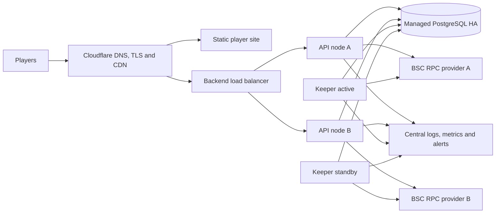

# BAI production infrastructure

## Target layout

The static player site is served through a CDN. The API and chain keeper run on separate application nodes, so one node can fail or be updated while the other remains available. A managed database with automatic failover and point-in-time recovery avoids making a single self-hosted database the failure point.

## Initial production size

| Component | Starting specification | Availability requirement |
| --- | --- | --- |
| Player site | Cloudflare Pages or GitHub Pages | CDN-backed; no application VM required |
| API | 2 Ubuntu 24.04 LTS VMs, each 2 vCPU, 4 GB RAM, 80 GB SSD | Separate availability zones, private network, health-checked load balancer |
| Database | Managed PostgreSQL, 2 vCPU / 4 GB RAM starting size | HA standby, automated backups, point-in-time recovery, encrypted connections |
| BSC RPC | Two independent provider endpoints | Fail over on timeout, rate limit, or stale block height |
| Monitoring | Managed uptime checks plus central logs, metrics and alerts | External health check must not run on the same VMs |

The two API nodes are a starting footprint, not a capacity guarantee. Static delivery does not consume these VM resources. Capacity should be adjusted from measured API latency, database load, RPC throttling, and keeper queue age.

## Keeper operation

The keeper is a separate process from the public API. It watches the contracts and submits the permissionless transactions needed to request and publish daily randomness, settle bounded batches, process liquidity, settle free rewards, and complete synthesis requests.

Run one active keeper and one standby. Both use a renewable database lease so only one submits a given job at a time. Before every transaction, the keeper checks chain state and uses the contract's current round/request identifiers; retries must be safe after a timeout where the transaction may already have mined. A stale or expired lease must fence the old worker before the standby becomes active.

Keep keeper signing funds separate from deployment, treasury, and VRF subscription ownership. Store signing material in the cloud secret manager or a dedicated signing service, never in the repository, an image, a browser, or ordinary application logs. Alert on keeper heartbeat loss, pending VRF age, oldest unsettled queue item, failed transactions, and subscription balance.

## Deployment and recovery controls

- Expose only HTTPS through the load balancer. Keep PostgreSQL and application ports private; restrict administrative access to key-based SSH or a provider session manager.
- Configure automatic process restart, startup health checks, readiness checks, and graceful shutdown. Do not route requests to an unhealthy node.
- Deploy immutable versioned images. Run database migrations as a separate, backward-compatible step; verify health before shifting traffic and retain the previous image for rollback.
- Use two RPC providers with timeouts and bounded retries. Do not retry a transaction blindly: reconcile the nonce and transaction receipt first.
- Back up PostgreSQL automatically and enable point-in-time recovery. Run a restore rehearsal before launch and after changing the backup policy.
- Keep logs centralized and structured. Redact addresses where not operationally necessary, all credentials, signing material, pairing tokens, and transaction payload secrets. Set retention and access controls.
- Monitor the public website, API readiness, database failover, RPC block freshness, VRF fulfillment, queue lag, and BNB balances from a separate monitoring provider.
- Test one-node loss, database failover, RPC-provider failure, keeper failover, backup restore, and rollback before opening the site to players.

## Binance Wallet connection boundary

The public dApp connects through the Binance Web3 EIP-1193 provider in the Binance App DApp browser (or official browser extension). Address and asset reads do not require a message signature; the wallet is prompted only after the player starts a transaction. This proves the connected Binance Web3 address, not that the address is specifically an Agentic Wallet.

Do not deploy `wallet-bridge.mjs` or expose its `/api/auth/*` routes publicly. It is a loopback-only development helper, and it must not be used as a third-party Agentic Wallet sign-in service. Binance's [Agentic Wallet security FAQ](https://www.binance.com/en/support/faq/detail/3ff00e2d488a41c4aaa4aabb6fc36763) says users should not scan a third-party website's QR code to sign in because the site may gain actual wallet control. If the product needs to prove Agentic Wallet identity specifically, use an official integration approved for that purpose; otherwise identify purchases by the on-chain sender and let users connect a standard wallet provider for address-scoped reads.

## Current repository status

The repository now contains the API, PostgreSQL schema and migrations, BSC event indexer, keeper worker, Docker image, and a Compose deployment definition. These files are deployment code; they do not mean that a production database, RPC account, cloud secrets, load balancer, or mainnet contracts have been provisioned or verified.

Before production traffic, configure and validate the managed PostgreSQL service, two independent BSC RPC providers, deployed mainnet contract addresses and deployment block, Chainlink VRF subscription and keeper funding, cloud secret delivery, HTTPS load balancer, backups, and alerting. The frontend must also be pointed to the reviewed mainnet contracts after deployment. The local Binance Agentic Wallet pairing bridge remains a local development component and is not an internet-facing production service.
